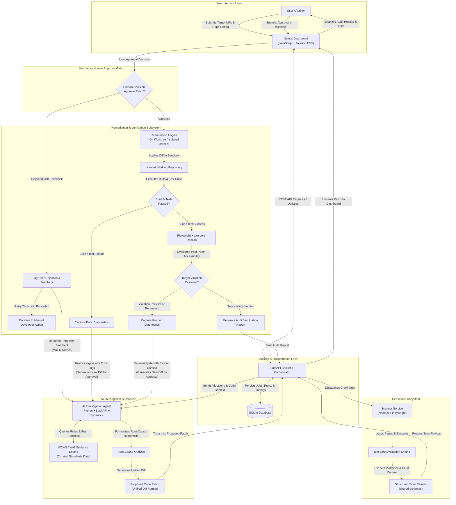

# Resolvr AI

**Detect. Investigate. Resolve. Verify.**

*An Agentic AI System for Website Accessibility Investigation, Remediation, and Verification.*

[](#project-status)
[](#contributors-and-license)
[](#technology-stack)
[](#technology-stack)
[](#technology-stack)
[-black?style=flat-square&logo=next.js&logoColor=white)](#technology-stack)
[](#technology-stack)
[](#technology-stack)
[](#references)

---

## Table of Contents

- [Project Status](#project-status)
- [Overview](#overview)
- [Problem Statement](#problem-statement)
- [Proposed Solution](#proposed-solution)
- [Key Features and Development Status](#key-features-and-development-status)
- [Agentic AI Architecture](#agentic-ai-architecture)
- [System Architecture Diagram](#system-architecture-diagram)
- [Detailed Agentic Workflow](#detailed-agentic-workflow)
- [Technology Stack](#technology-stack)
- [Repository Structure](#repository-structure)
- [Installation and Setup](#installation-and-setup)
- [How to Use Resolvr AI](#how-to-use-resolvr-ai)
- [Demonstration Scenario](#demonstration-scenario)
- [Team and Responsibilities](#team-and-responsibilities)
- [Security and Responsible AI](#security-and-responsible-ai)
- [Testing and Evaluation](#testing-and-evaluation)
- [Development Roadmap](#development-roadmap)
- [Limitations](#limitations)
- [Future Scope](#future-scope)
- [References](#references)
- [Contributors and License](#contributors-and-license)

---

## Project Status

**Status: Under Active Development**

Resolvr AI is currently being developed as an academic university Agentic AI project. The end-to-end architecture, technology stack, component boundaries, and cross-module communication schemas have been planned and established. Individual subsystems are being actively built and integrated by designated team members.

> **Important Implementation Notice:**
> The project is in active pre-release development. The repository currently hosts project scaffolding, architectural specifications, and directory structures. Subsystems such as the automated browser scanner, AI investigator agent, remediation engine, API backend, and dashboard UI are being authored on component feature branches and will be integrated iteratively. Functional installation and runtime instructions will be finalized as each component's implementation code and package manifests are committed.

---

## Overview

**Resolvr AI** is an agentic AI-powered website accessibility investigation and remediation platform. It assists software developers, website owners, educational institutions, digital agencies, and public sector organizations in navigating the complexity of digital accessibility compliance.

Web accessibility is a fundamental requirement for an inclusive digital ecosystem and a legal obligation under frameworks such as Section 508, the Americans with Disabilities Act (ADA), and the European Accessibility Act (EAA). However, bridging the gap between automated issue detection and durable source-code remediation remains a significant challenge.

Traditional accessibility scanners are strictly descriptive: they analyze rendered web pages and report accessibility rule violations, leaving the burden of diagnosing the underlying cause, consulting complex standards, and authoring source-code fixes entirely to humans.

Resolvr AI aims to transform this static model into an active, closed-loop workflow:

```text
Detect → Investigate → Resolve → Verify
```

By coupling automated browser-based scanning with an **evidence-grounded Agentic AI Investigator**, a **human-in-the-loop Remediation Engine**, and an **isolated Verification Subsystem**, Resolvr AI connects violation detection directly to validated source-code solutions.

### Why Agentic AI?

Resolvr AI is neither a simple chatbot nor a repackaged command-line scanner. It employs genuine agentic behavior:
- **Multi-Step Investigation:** Rather than answering a one-shot prompt, the agent breaks complex accessibility failures into systematic investigative steps.
- **LLM Tool Calling:** The agent dynamically queries rule engines, retrieves authoritative WCAG/WAI guidance, and inspects contextual DOM trees.
- **Evidence-Grounded Reasoning:** Conclusions are tied to concrete DOM node hierarchies, attribute states, styling contexts, and rendered element geometries.
- **Root-Cause Grouping:** The agent cross-references findings across distinct pages to isolate shared component templates (e.g., navigation bars, form inputs) rather than treating each rendered occurrence as an isolated bug.
- **Human-Controlled Code Modification:** All proposed source-code patches require explicit human review and approval prior to being applied in isolated sandboxes.
- **Bounded Autonomous Retries:** If an approved patch fails verification or unit testing, the agent analyzes the failure diagnostics and re-investigates within bounded retry limits—always returning to human review for subsequent patch iterations.

---

## Problem Statement

Modern web development relies heavily on component-driven architectures, complex styling systems, dynamic client-side rendering, and continuous delivery. In this environment, ensuring web accessibility poses systemic challenges:

1. **Scanners Only Detect Rendered Symptoms:** Tools like axe-core identify issues on the rendered DOM of a specific page, but they cannot deduce the source code structure, component hierarchy, or build-time styling rules that created the defect.
2. **High Diagnostic Burden on Developers:** Developers must manually trace a rendered element back through component templates, state hooks, and stylesheets to determine where the bug originated.
3. **Repeated Findings from Shared Components:** A single inaccessible icon button in a shared header component will manifest as a separate violation on every crawled page, flooding developers with repetitive noise and obscuring the root cause.
4. **Abstract Accessibility Guidance:** W3C Web Content Accessibility Guidelines (WCAG) and WAI-ARIA Authoring Practices are detailed technical specifications that require specialized expertise to translate into clean, framework-idiomatic source code.
5. **Time-Intensive Manual Remediation:** Manually drafting, testing, and styling accessible alternatives across dozens of violations consumes substantial engineering hours.
6. **Lack of Automated Fix Verification:** Applying a code change does not guarantee that the accessibility defect was eliminated or that unexpected visual or functional regressions were avoided.
7. **Automated Testing Limitations:** Automated accessibility evaluation algorithms can detect approximately 30% to 57% of accessibility barriers; they cannot evaluate subjective compliance (such as the context-specific accuracy of alternative text) without grounded reasoning and human judgment.

Resolvr AI addresses these hurdles by providing an end-to-end framework that pinpoints root causes, retrieves tailored WCAG techniques, produces precise unified diffs, enforces human authorization, and verifies post-patch outcomes.

---

## Proposed Solution

Resolvr AI unifies automated scanning, AI-driven diagnostics, source patching, and regression verification into a single orchestrated platform:

```text
Website Submission
  └── Accessibility Scanning (axe-core + Playwright)
        └── Structured Evidence Collection (DOM + CSS Context)
              └── AI Agent Investigation & WCAG Guidance Retrieval
                    └── Component-Level Root-Cause Analysis
                          └── Unified Diff Patch Proposal
                                └── Mandatory Human Review & Approval
                                      └── Isolated Git Worktree Patch Application
                                            └── Build, Test, & Automated Rescanning
                                                  └── Comprehensive Verification Report
```

### Key Solution Capabilities

1. **Authorized Multi-Page Crawling:** Scans target domains within explicitly configured URL boundaries, respecting crawling scope and security constraints.
2. **axe-core Engine Integration:** Evaluates pages against international accessibility standards (WCAG 2.0, 2.1, 2.2 Levels A and AA).
3. **Structured Evidence Collection:** Captures selector paths, bounding boxes, parent/child DOM snippets, computed styles, and accessibility tree snapshots.
4. **Agentic Root-Cause Investigation:** Utilizes LLM tool-calling capabilities to formulate and test hypotheses regarding why an element failed WCAG criteria.
5. **Curated Guidance Retrieval:** Automatically matches violations to normative WCAG success criteria, WAI-ARIA patterns, and proven implementation techniques.
6. **Cross-Page Violation Deduplication:** Groups identical rendered defects originating from common templates or layout components into unified remediation tasks.
7. **Source-Code Patch Synthesis:** Formulates idiomatic source-code diffs targeting component templates and stylesheets.
8. **Mandatory Human-in-the-Loop Gate:** Enforces explicit human developer approval for every generated or revised code patch.
9. **Isolated Patch Execution:** Applies approved patches in isolated Git branches or worktrees, shielding production codebases from uncontrolled modifications.
10. **Automated Build and Unit Testing:** Validates that code modifications do not introduce syntactic syntax errors, build failures, or broken test suites.
11. **Post-Remediation Rescanning:** Re-runs the automated scanner against the patched build to verify that target violations are resolved and no secondary violations were introduced.
12. **Verification Auditing & Reporting:** Generates structured before-and-after audit logs demonstrating the remediation status and remaining items requiring human evaluation.

> **Permission & Security Boundary:**
> Source-code patching strictly requires authorized access to the target project's Git repository. Submitting a public website URL allows Resolvr AI to scan and investigate rendered violations, but the system **cannot and will not** attempt source-code patching without verified local or remote repository permissions and explicit human approval.

---

## Key Features and Development Status

The following matrix reflects the current implementation status of Resolvr AI's feature set based on verified repository contents:

### Implemented
- [x] **Project Repository Scaffolding:** Clean, top-level multi-directory project architecture separating backend, frontend, scanner, investigator, remediation, schemas, demo, and test suites.
- [x] **Architectural Blueprint & Data Flow Specification:** End-to-end multi-agent design, system contracts, and workflow definitions.
- [x] **Team Responsibility Matrix:** Allocated ownership across scanner, AI investigation, remediation, full-stack orchestration, and demo targets.
- [x] **Open-Source Documentation:** Foundational repository overview and development guidelines.

### In Progress
- [ ] **Curated WCAG 2.2 Guidance Dataset:** Structuring normative rules, ARIA authoring patterns, and remediation examples for agent retrieval.
- [ ] **Shared JSON Contracts (`shared-schemas/`):** Pydantic and JSON schemas defining data structures for scan results, investigation records, patch proposals, and verification reports.
- [ ] **CampusConnect Demonstration Site (`demo-website/`):** React + Vite accessible/inaccessible testbed featuring controlled accessibility violations for end-to-end evaluation.
- [ ] **Environment Variable Specifications (`.env.example`):** Parameter templates for LLM API keys, browser configurations, backend ports, and database connections.

### Planned
- [ ] **Headless Scanner Engine (`scanner/`):** Node.js service driving Playwright and axe-core with multi-page crawling and structured DOM extraction.
- [ ] **AI Investigation Agent (`investigator/`):** Python agent integrating LLM tool calling, root-cause hypothesis generation, and guidance retrieval.
- [ ] **Remediation Engine (`remediation/`):** Source-code diff generation, Git worktree isolation, build verification, and rescan orchestration.
- [ ] **FastAPI Orchestration Backend (`backend/`):** REST API endpoints managing scan jobs, investigation workflows, human approval gates, and SQLite persistence.
- [ ] **Interactive Management Dashboard (`frontend/`):** Next.js + JavaScript dashboard for URL submission, real-time scan progress, finding visualization, diff inspection, and patch approval.
- [ ] **Automated Test Harness (`tests/`):** Comprehensive unit, integration, and end-to-end test suites evaluating detection accuracy and remediation safety.

---

## Agentic AI Architecture

Resolvr AI divides responsibilities between deterministic software engines and an autonomous, evidence-grounded AI agent:

```text
┌────────────────────────────────────────────────────────────────────────┐
│                        DETERMINISTIC SYSTEMS                           │
│  ┌───────────────────────┐                  ┌───────────────────────┐  │
│  │   Playwright Scanner  │                  │  Remediation Engine   │  │
│  │  • Browser crawling   │                  │  • Git worktree setup │  │
│  │  • axe-core rules     │                  │  • Patch application  │  │
│  │  • DOM extraction     │                  │  • Build / Unit tests │  │
│  └───────────┬───────────┘                  └───────────▲───────────┘  │
└──────────────┼──────────────────────────────────────────┼──────────────┘
               │ Structured Findings                      │ Approved Patches
               ▼                                          │
┌─────────────────────────────────────────────────────────┴──────────────┐
│                       AUTONOMOUS AGENTIC CORE                          │
│  ┌──────────────────────────────────────────────────────────────────┐  │
│  │  AI Investigation Agent (Python + LLM Tool Calling)              │  │
│  │  • Multi-step diagnostic reasoning                               │  │
│  │  • Contextual DOM tree & CSS inspection                          │  │
│  │  • Dynamic WCAG 2.2 guidance retrieval                           │  │
│  │  • Cross-page finding deduplication & root-cause identification  │  │
│  │  • Synthesis of framework-specific unified diffs                 │  │
│  │  • Bounded diagnostic analysis of failed builds or rescans       │  │
│  └──────────────────────────────────────────────────────────────────┘  │
└────────────────────────────────────────────────────────────────────────┘
```

### 1. Website Scanner (`scanner/`)
- **Engine:** Node.js, Playwright, and axe-core.
- **Role:** Autonomous crawling of target pages within predefined URL route patterns.
- **Output:** Normalized JSON documents detailing violation type, WCAG tags, impact level, DOM selectors, target HTML snippets, and accessibility tree nodes.

### 2. AI Investigation Agent (`investigator/`)
- **Engine:** Python, LLM API client, Pydantic.
- **Role:** Analyzes raw scanner output using structured tool calling. It formulates hypotheses regarding the root cause of an issue, determines whether multiple violations share an underlying component, queries WCAG guidance, and drafts minimal source-code repairs.
- **Constraints:** Operates under strict prompt contracts and bounded tool iteration limits to prevent infinite reasoning loops.

### 3. Guidance Retrieval Engine
- **Engine:** Curated WCAG 2.2, WAI-ARIA 1.2, and W3C Techniques repository.
- **Role:** Maps specific axe-core rule identifiers (e.g., `button-name`, `color-contrast`, `label`) to canonical W3C remediation techniques, providing authoritative technical context to the AI agent.

### 4. Remediation Engine (`remediation/`)
- **Engine:** Python, Git version control, standard build tools.
- **Role:** Converts the agent's proposed repairs into standard unified diffs (`.patch`), isolates application to dedicated Git branches or worktrees, executes local build and unit test commands, and triggers post-patch rescanning.

### 5. Backend and Orchestration (`backend/`)
- **Engine:** Python, FastAPI, SQLite database.
- **Role:** Manages job queues, persists scan and remediation states, coordinates inter-service communications, exposes RESTful APIs to the frontend, and guarantees that patch proposals halt at the human approval gate.

### 6. Frontend Dashboard (`frontend/`)
- **Engine:** Next.js (React / JavaScript), Tailwind CSS.
- **Role:** Provides user-facing controls to launch audits, inspect accessibility metrics, navigate DOM evidence, review highlighted diff proposals, submit approvals or rejections, and export verification reports.

---

## System Architecture Diagram

The following flowchart illustrates the complete lifecycle of an investigation and remediation task within Resolvr AI. Note that every newly generated or revised patch must pass through the **Human Approval Decision** before it can be applied to source files.



---

## Detailed Agentic Workflow

Resolvr AI operates across ten systematic stages, blending automated execution with human oversight:

| Stage | Input | Action or Tool | Output | Automation Level | Human Intervention |
|---|---|---|---|---|---|
| **1. Website Submission** | Target URL, crawl limits, repository path | Next.js Dashboard / FastAPI | Validated scan job record | Interactive | User enters target scope and initiates audit |
| **2. Automated Scanning** | Target URLs | Node.js + Playwright browser | Rendered DOM pages, network state | Fully Autonomous | None |
| **3. Evidence Collection** | Active page sessions | axe-core rule injection, DOM serializer | Structured JSON scan findings with DOM snippets | Fully Autonomous | None |
| **4. AI Investigation** | Scan findings, code snippets | Python AI Agent (LLM tool calling) | Diagnostic traces, matched WCAG techniques | Autonomous Agentic | None |
| **5. Root-Cause Analysis** | Grouped findings, component context | AI Agent cross-page reasoning | Root-cause diagnosis (shared component vs. single page) | Autonomous Agentic | None |
| **6. Remediation Proposal** | Root-cause analysis, source files | Patch generator tool | Synthesized unified diff (`.patch`) | Autonomous Agentic | None |
| **7. Human Approval** | Unified diff, reasoning explanation | Dashboard diff viewer | Approval (`True`/`False`), developer feedback | **Strict Human Gate** | **Mandatory review & explicit decision** |
| **8. Controlled Patch Application** | Approved diff, target repo | Git worktree manager, build runners | Patched isolated branch, build status | Automated (Deterministic) | None (conditional on stage 7 approval) |
| **9. Automated Verification** | Patched application | Local build run, Playwright + axe-core rescan | Before-and-after audit logs, diff status | Fully Autonomous | None |
| **10. Final Reporting** | Verification results, unresolved items | Reporting module | Structured verification report (JSON/Markdown) | Automated | Review of final audit report |

---

## Technology Stack

The intended technology stack emphasizes reliability, strict data validation, and clear architectural separation between asynchronous services:

| Component | Technology | Purpose | Responsible Member | Implementation Status |
|---|---|---|---|---|
| **Demo Website** | React, JavaScript, Vite | Purpose-built demonstration site containing controlled accessibility defects | Shared Team Responsibility | Planned / Under Design |
| **Scanner** | Node.js, Playwright, axe-core | Headless browser crawling, accessibility rule evaluation, DOM extraction | Paheli Choudhuri | Planned / Under Design |
| **AI Investigator** | Python, LLM API, Pydantic | Multi-step agentic reasoning, tool use, evidence inspection, root-cause diagnosis | Sainy | Planned / Under Design |
| **WCAG Guidance** | Curated W3C WCAG 2.2 / WAI Data | Normative rule mapping, ARIA authoring patterns, accessible code examples | Sainy | In Progress |
| **Remediation Engine** | Python, Git, Patch utilities | Unified diff generation, worktree isolation, build verification, rescan integration | Aditya Ghate | Planned / Under Design |
| **Backend & Orchestrator** | Python, FastAPI, Uvicorn | Workflow coordination, state machine, job queues, REST API endpoints | Arunika | Planned / Under Design |
| **Frontend Dashboard** | Next.js, JavaScript, Tailwind CSS | Web dashboard, audit initiation, diff visualization, human approval gate | Arunika | Planned / Under Design |
| **Database** | SQLite | Initial lightweight relational persistence for scan records, findings, and patch jobs | Arunika | Planned / Under Design |
| **Testing Suite** | pytest, Playwright, Node test runner | Unit, integration, and end-to-end regression testing | Shared Team Responsibility | Planned / Under Design |
| **Version Control** | Git, GitHub | Distributed version control, peer code review, issue tracking | Shared Team Responsibility | Implemented / Active |

> **Architectural Rules:**
> - **Language Selection:** The frontend dashboard and demo website use **JavaScript** (React / Next.js) rather than TypeScript to maintain rapid educational iteration and broad accessibility for contributors.
> - **Data Validation:** Python components use **Pydantic** models to strictly validate inputs and outputs against shared JSON schema contracts.
> - **Version Manifests:** Dependency versions will be pinned in respective package manifests (`package.json`, `requirements.txt`) as each module is implemented.

---

## Repository Structure

The repository maintains an intentional, modular top-level layout. All major subsystems are decoupled into dedicated directories:

```text
RESOLVR-AI/
├── backend/            # FastAPI backend, workflow orchestration, APIs, and SQLite integration
├── demo-website/       # React + JavaScript + Vite demonstration website (CampusConnect)
├── docs/               # Architecture, development, research, and integration documentation
├── frontend/           # Next.js + JavaScript + Tailwind CSS management dashboard
├── investigator/       # Python-based AI investigation agent and WCAG guidance retrieval
├── remediation/        # Source-code patch proposals, Git isolation, and verification
├── scanner/            # Node.js + Playwright + axe-core accessibility scanning
├── shared-schemas/     # Shared JSON schemas for cross-component communication contracts
├── tests/              # Unit, integration, and end-to-end tests
├── .env.example        # Environment variable template
├── .gitignore          # Git exclusion rules
└── README.md           # Project documentation and architectural guide
```

### Verified Directory Responsibilities

| Directory | Purpose | Current Repository State |
|---|---|---|
| `backend/` | Hosts the FastAPI REST service, asynchronous task manager, SQLite database models, and workflow orchestration logic. | Directory scaffolding present. |
| `demo-website/` | Hosts the "CampusConnect" React + Vite demonstration application containing realistic accessibility violations for system evaluation. | Directory scaffolding present. |
| `docs/` | Contains system architecture diagrams, API specifications, WCAG research documents, and meeting records. | Directory scaffolding present. |
| `frontend/` | Hosts the Next.js web application for configuring audits, reviewing findings, inspecting AI reasoning, and approving patches. | Directory scaffolding present. |
| `investigator/` | Contains the Python agent implementation, prompt templates, tool definitions, and WCAG guidance lookup modules. | Directory scaffolding present. |
| `remediation/` | Houses patch generation tools, Git sandbox isolation routines, automated test runners, and rescan verifiers. | Directory scaffolding present. |
| `scanner/` | Contains the Playwright crawler scripts, axe-core test harnesses, and DOM evidence extraction pipelines. | Directory scaffolding present. |
| `shared-schemas/` | Houses canonical JSON schemas governing data exchange between the scanner, backend, AI agent, and remediation engine. | Directory scaffolding present. |
| `tests/` | Contains automated test suites for Python and Node.js components, integration tests, and mock agent evaluation scripts. | Directory scaffolding present. |

### Planned Internal Module Structure

As development progresses, the subdirectories will be populated with the following planned files:

```text
backend/
├── app/
│   ├── main.py                 # FastAPI application entry point
│   ├── api/                    # Route handlers (scans, investigations, patches)
│   ├── core/                   # Configuration, state engine, and task runners
│   └── models/                 # SQLite database models and Pydantic schemas
└── requirements.txt            # Python dependencies (FastAPI, Uvicorn, SQLAlchemy)

demo-website/
├── src/                        # React components (accessible and flawed variants)
├── package.json                # React and Vite dependencies
└── vite.config.js              # Vite bundler configuration

frontend/
├── pages/                      # Next.js routes (dashboard, scan view, patch review)
├── components/                 # UI components (diff viewer, findings table, approval modal)
├── styles/                     # Tailwind CSS stylesheets
└── package.json                # Next.js, React, and Tailwind dependencies

investigator/
├── agent/                      # Core agent reasoning loop and prompt definitions
├── tools/                      # Tool implementations (DOM query, WCAG lookup)
├── guidance/                   # Curated WCAG 2.2 rules and remediation examples
└── requirements.txt            # Python dependencies (Pydantic, LLM client SDK)

remediation/
├── patcher/                    # Diff generator and Git worktree manager
├── verifier/                   # Build runner and post-patch scan orchestrator
└── requirements.txt            # Python dependencies

scanner/
├── src/                        # Playwright crawler, axe-core runner, serializer
└── package.json                # Node.js dependencies (Playwright, axe-core)

shared-schemas/
├── scan-result.schema.json     # Schema for scanner output
├── investigation.schema.json   # Schema for agent diagnostic findings
├── patch-proposal.schema.json  # Schema for proposed code diffs
└── verification.schema.json    # Schema for post-remediation audit reports
```

---

## Installation and Setup

> **Note on Implementation Status:**
> Setup instructions will be finalized as each component's implementation code and dependency manifests are committed to the repository. The commands below document standard repository initialization.

### Prerequisites

- **Git:** Version 2.30+ installed
- **Python:** Version 3.10 or higher
- **Node.js:** Version 18.x or higher with `npm`

### 1. Repository Setup

Clone the repository to your local development environment:

```bash
git clone https://github.com/Sainyy56/RESOLVR-AI.git
cd RESOLVR-AI
```

### 2. Environment Configuration

Copy the provided environment template to configure local variables:

```bash
cp .env.example .env
```

*(Planned environment variables include LLM API credentials, backend service ports, Playwright browser configurations, and database file paths. Specific configuration keys will be documented in `.env.example` as backend components are committed.)*

### 3. Component-Specific Setup

#### Backend Setup (`backend/`)
*Setup instructions will be added when this component is implemented.*

#### AI Investigator Setup (`investigator/`)
*Setup instructions will be added when this component is implemented.*

#### Remediation Engine Setup (`remediation/`)
*Setup instructions will be added when this component is implemented.*

#### Scanner Setup (`scanner/`)
*Setup instructions will be added when this component is implemented.*

#### Frontend Dashboard Setup (`frontend/`)
*Setup instructions will be added when this component is implemented.*

#### Demo Website Setup (`demo-website/`)
*Setup instructions will be added when this component is implemented.*

#### Running Tests (`tests/`)
*Setup instructions will be added when this component is implemented.*

---

## How to Use Resolvr AI

The conceptual end-to-end user journey for an auditor or developer using Resolvr AI is planned as follows:

```text
[Step 1: Dashboard Access]
       │
       ▼
[Step 2: Enter Authorized URL & Repo Path]
       │
       ▼
[Step 3: Launch Scan] ──► [Step 4: Review Detected Violations]
                                     │
                                     ▼
                          [Step 5: Inspect AI Root-Cause Analysis]
                                     │
                                     ▼
                          [Step 6: Review Proposed Code Diff]
                                     │
                                     ▼
                          [Step 7: Human Decision: Approve or Reject]
                                     ├── Reject ──► Feedback logged, patch discarded
                                     │
                                     └── Approve ──► [Step 8: Isolated Sandbox Patching]
                                                            │
                                                            ▼
                                                     [Step 9: Automated Build & Rescan]
                                                            │
                                                            ▼
                                                     [Step 10: Final Verification Report]
```

1. **Access the Dashboard:** Open the Next.js web interface in your browser.
2. **Submit Target Scope:** Input the URL of an authorized website and specify the local path or repository link for source code.
3. **Execute Automated Scan:** The scanner crawls the permitted routes, running axe-core to identify accessibility violations.
4. **Inspect Findings:** View an aggregated breakdown of issues categorized by WCAG criteria (e.g., Level A, Level AA, contrast, accessible names).
5. **Review AI Diagnostics:** Examine the agent's explanation detailing the likely root cause of the violation and why the failure occurred.
6. **Evaluate Code Diff:** Inspect a syntax-highlighted unified diff (`.patch`) illustrating the exact proposed adjustments to the markup or styling.
7. **Submit Human Decision:**
   - **Approve:** Authorizes the remediation engine to apply the patch in an isolated branch.
   - **Reject:** Discards the patch or provides feedback to guide a bounded re-investigation.
8. **Monitor Verification:** Track the automated sandbox build and Playwright rescan in real time.
9. **Export Audit Report:** Download the final verification summary certifying resolved violations and detailing manual audit advisories.

---

## Demonstration Scenario

To validate and demonstrate Resolvr AI under controlled conditions, the team is building **CampusConnect**, a fictional university portal located in `demo-website/`.

CampusConnect simulates a typical educational web application containing both accessible patterns and intentional, real-world accessibility defects:

```text
CampusConnect Portal (Planned Demo Website)
├── Header & Navigation (Global shared component)
│   └── Defect: Unlabeled icon-only search button (WCAG 4.1.2)
├── Student Registration Form (Page-specific template)
│   └── Defect: Input field lacking explicit label association (WCAG 1.3.1 / 3.3.2)
├── Campus Event Announcements (Component card)
│   └── Defect: Low-contrast text on muted background (WCAG 1.4.3)
└── Footer (Global shared component)
    └── Repeated Defect: Contrast and missing landmarks across all routes
```

### Illustrative Walkthrough (Hypothetical)

1. **Detection:** The scanner evaluates three distinct pages of CampusConnect and identifies four violations of WCAG 4.1.2 (`button-name`) occurring on the header search element across all three routes.
2. **Investigation & Deduplication:** The AI agent analyzes the DOM selector chains and recognizes that each instance originates from a single shared component (`Header.jsx`).
3. **Guidance Retrieval:** The agent retrieves W3C Technique `H91` and ARIA Authoring Practices Guide advice for accessible buttons.
4. **Patch Synthesis:** The agent proposes adding an `aria-label="Search campus portal"` attribute to the button element in `Header.jsx`.
5. **Approval:** The developer inspects the diff on the dashboard and selects **Approve**.
6. **Remediation & Rescan:** The engine applies the diff in an isolated branch, verifies that the React build passes, and re-executes axe-core.
7. **Verification:** The four recurring violations across all routes are confirmed resolved, and a verification report is generated.

*(Note: The scenario above is illustrative of planned system capabilities; precise metrics, scan results, and diff outputs will be captured during Phase 4 testing.)*

---

## Team and Responsibilities

Resolvr AI is engineered by a four-member development team with clearly defined subsystem ownership:

| Member | Primary Subsystem Ownership | Core Responsibilities |
|---|---|---|
| **Paheli Choudhuri** | **Website Scanning & Evidence Collection** | • Playwright browser automation and crawler configuration<br/>• axe-core rules integration and custom test passes<br/>• DOM evidence extraction, bounding box, and style collection<br/>• Structured scan result serialization (`shared-schemas`) |
| **Sainy** | **AI Investigation, WCAG Research, & Documentation** | • LLM API integration and agent reasoning design<br/>• Structured tool calling and evidence inspection algorithms<br/>• Root-cause analysis and finding grouping logic<br/>• Curated WCAG 2.2 / WAI guidance retrieval dataset<br/>• Repository management, system architecture docs, and README maintenance |
| **Aditya Ghate** | **Remediation & Verification Engine** | • Source-code patch generation and unified diff synthesis<br/>• Git worktree and isolated branch management<br/>• Controlled patch application under approval gating<br/>• Build execution, test suite execution, and rescan orchestration |
| **Arunika** | **Full-Stack Platform & Orchestration** | • Next.js + JavaScript dashboard development with Tailwind CSS<br/>• FastAPI orchestration service and asynchronous job management<br/>• SQLite database models and state machine implementation<br/>• Human approval gate interfaces and diff review components |
| **Shared Team Responsibility** | **Integration & Evaluation** | • Development of the CampusConnect demo website<br/>• Cross-subsystem schema definitions (`shared-schemas`)<br/>• End-to-end integration testing and bug triaging<br/>• Final project presentation and evaluation documentation |

---

## Security and Responsible AI

Resolvr AI is designed with strict boundaries to ensure that automated scanning and AI-assisted code remediation operate safely:

### 1. Scope and Target Authorization
- Scans are restricted to user-authorized domain boundaries.
- URL validation and loopback/internal IP filtering will be enforced to mitigate Server-Side Request Forgery (SSRF) risks against local private networks.

### 2. Handling Untrusted Content & Prompt Injection
- Scanned websites contain untrusted third-party DOM strings, attributes, and user-generated text.
- The AI investigator treats DOM snippets strictly as data inputs, using structured schema parsing rather than raw string interpolation.
- While prompt-injection defenses and schema boundaries reduce risks, the system acknowledges that prompt sanitization cannot completely eliminate injection vulnerabilities; hence, the human approval gate acts as a mandatory safety checkpoint.

### 3. API Key & Credential Protection
- All API keys, database credentials, and service tokens are managed via environment variables and excluded from Git tracking via `.gitignore`.
- Example templates in `.env.example` will contain only placeholder strings.

### 4. Mandatory Human Approval Gate
- The AI agent is technically barred from directly writing changes into an active branch or production repository.
- Every generated diff must be explicitly reviewed and accepted by a human developer through the dashboard.

### 5. Sandboxed Patch Application
- Approved patches are applied within isolated Git worktrees or detached branches.
- Local build scripts and unit tests are executed in constrained sub-processes.
- The system includes bounded retry counters (e.g., maximum 3 attempts) to prevent runaway patch generation loops when builds fail.

### 6. No Automated Production Deployment
- Resolvr AI does not trigger production releases or commit directly to default branches (`main`/`master`). All changes remain as reviewable branches or pull requests.

---

## Testing and Evaluation

The Resolvr AI project will be evaluated across both academic benchmarks and practical software engineering criteria:

### Evaluation Criteria

1. **Accessibility Detection Accuracy:** Comparing scan outputs against established test suites (such as the W3C Web Accessibility Initiative test cases) to evaluate false positive and false negative rates.
2. **Evidence Completeness:** Measuring the proportion of findings that capture complete selector paths, computed styles, and accessibility tree context.
3. **Root-Cause Diagnostic Precision:** Evaluating the agent's ability to identify the root cause of an accessibility barrier rather than merely restating the rule violation.
4. **WCAG Mapping Correctness:** Verifying that retrieved guidance and techniques accurately correlate with the applicable WCAG 2.2 success criteria.
5. **Patch Syntactic & Semantic Validity:** Checking whether proposed unified diffs compile without errors, adhere to target framework idioms, and preserve existing functionality.
6. **Verification Efficacy:** Demonstrating that post-patch rescans confirm the resolution of target issues without introducing regressions.
7. **Workflow Resilience & Safety:** Ensuring that approval gates never fail open and that bounded retry limits cleanly terminate unresolvable tasks.

> **Evaluation Principle:**
> Automated scanning tools detect only a subset of WCAG criteria. Complete accessibility evaluation requires human verification of subjective requirements, including screen-reader interaction, reading order logic, and semantic clarity.

---

## Development Roadmap

The project follows a phased implementation plan. Completed milestones reflect verified repository assets:

### Phase 1 — Planning and Setup
- [x] Define project scope, identity, and system architecture
- [x] Establish top-level repository folder structure
- [x] Assign subsystem ownership across team members
- [x] Draft initial open-source architectural documentation
- [ ] Define cross-component JSON schemas in `shared-schemas/`
- [ ] Author environment variable specifications in `.env.example`

### Phase 2 — Core Subsystem Development
- [ ] Implement CampusConnect React + Vite demo website (`demo-website/`)
- [ ] Build Playwright + axe-core crawler and evidence extractor (`scanner/`)
- [ ] Assemble curated WCAG 2.2 guidance dataset (`investigator/guidance/`)
- [ ] Implement AI investigation agent reasoning loop and tool calling (`investigator/`)
- [ ] Build patch generator, Git worktree manager, and build runner (`remediation/`)

### Phase 3 — Integration & Orchestration
- [ ] Implement FastAPI backend endpoints, state machine, and SQLite persistence (`backend/`)
- [ ] Develop Next.js dashboard UI, URL submission forms, and findings tables (`frontend/`)
- [ ] Construct interactive unified diff viewer with human approval controls (`frontend/`)
- [ ] Connect scanner, backend, and investigator via shared schemas
- [ ] Integrate remediation engine and rescan verifier with the approval gate

### Phase 4 — Testing, Verification & Demonstration
- [ ] Author unit and integration tests across Python and Node.js components (`tests/`)
- [ ] Conduct end-to-end evaluation against the CampusConnect demo suite
- [ ] Perform security and error-handling boundary tests (SSRF, timeout, retry limits)
- [ ] Finalize runtime documentation, demo scripts, and presentation materials

---

## Limitations

To maintain technical credibility and clear expectations, the following limitations of the system are acknowledged:

- **Automated Tool Boundaries:** Automated accessibility engines (including axe-core) can reliably assess roughly 30% to 57% of WCAG success criteria. Complex cognitive criteria, logical reading order, and video/audio media alternatives require human evaluation.
- **Probabilistic AI Outputs:** LLM-based reasoning is probabilistic; proposed patches may occasionally introduce stylistic anomalies or suboptimal markup, reinforcing the necessity of human approval.
- **Repository Access Requirement:** Automated patch proposal and testing require direct, authorized access to the underlying Git source repository. Auditing a remote website via URL alone cannot produce source-code patches without repository integration.
- **Regression Potential:** While automated builds and unit tests verify syntactic integrity, they cannot guarantee zero visual or functional regressions without comprehensive end-to-end regression test coverage.
- **Compliance Certification:** Passing an automated Resolvr AI scan does not constitute a formal legal guarantee of WCAG compliance or ADA immunity.

---

## Future Scope

Following initial university project completion, potential avenues for expansion include:

- **CI/CD Integration:** Packaging Resolvr AI as a GitHub Action or GitLab CI pipeline step to prevent accessibility regressions during pull request reviews.
- **Continuous Monitoring:** Scheduled cron audits that track accessibility compliance over time across dynamic enterprise websites.
- **Expanded Framework Support:** Extending patch synthesis from React to Vue.js, Angular, Svelte, and server-rendered HTML frameworks.
- **Screen Reader Simulation:** Integrating automated assistive technology simulators to evaluate accessibility tree announcements.
- **Historical Trend Analytics:** Long-term database analytics charting remediation velocity, frequent failure types, and team compliance progress.

---

## References

Official documentation and standards underpinning Resolvr AI:

- [W3C Web Content Accessibility Guidelines (WCAG) 2.2](https://www.w3.org/TR/WCAG22/)
- [W3C Web Accessibility Initiative (WAI)](https://www.w3.org/WAI/)
- [WAI-ARIA Authoring Practices Guide (APG)](https://www.w3.org/WAI/ARIA/apg/)
- [Deque axe-core Documentation](https://www.deque.com/axe/core-documentation/)
- [Playwright Testing Library](https://playwright.dev/)
- [FastAPI Framework Documentation](https://fastapi.tiangolo.com/)
- [Pydantic Data Validation](https://docs.pydantic.dev/)
- [Next.js Documentation](https://nextjs.org/docs)
- [React Documentation](https://react.dev/)
- [Vite Next Generation Frontend Tooling](https://vitejs.dev/)
- [SQLite Documentation](https://www.sqlite.org/docs.html)

---

## Contributors and License

### Team Members
- **Paheli Choudhuri**
- **Sainy**
- **Aditya Ghate**
- **Arunika**

### License
Licensing terms have not yet been specified for this repository. All rights are reserved by the project authors pending official open-source license selection.
